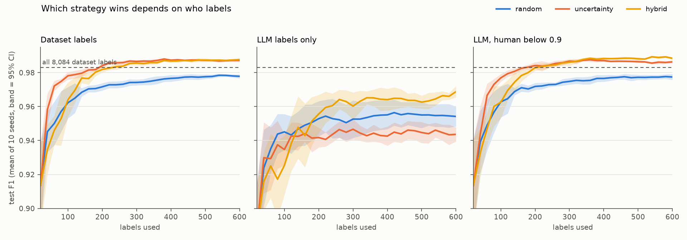
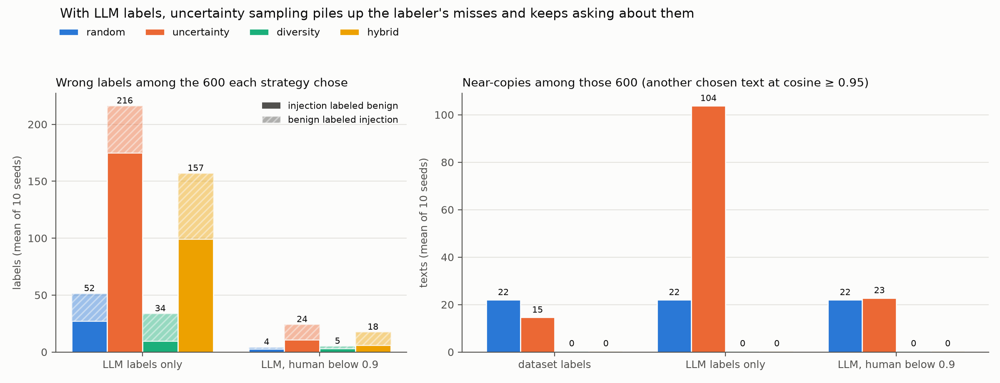
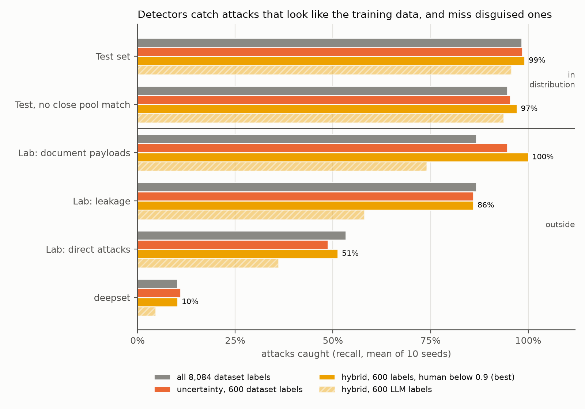

# Label-Efficient Prompt-Injection Detection

**Active learning with an LLM as an imperfect labeler: how few human labels does a good injection detector need?**

A prompt-injection detector is a classifier, and its cost is the labels: a person reading each text and deciding whether it tries to take over an AI system. This project measures two ways to cut that cost, together. **Active learning** lets the model choose which texts get labeled. **A local LLM labeler** labels texts for free, with mistakes. The question is whether the two combine, or whether active learning, which deliberately asks about the hardest texts, walks straight into the labeler's blind spot.

**Headline:** with correct labels, uncertainty sampling reaches 99% of the full-data detector's F1 with **60 labels instead of 260**, and 600 chosen labels beat all 8,084. With LLM labels that advantage **disappears**: uncertainty sampling keeps asking about the injections the LLM calls benign. Sending only the LLM's low-confidence texts to a person restores it: **27 human labels** reach the same quality that random sampling needs **260** for.



## The question, precisely

Five hypotheses were fixed before any experiment ran ([docs/00-project-overview.md](docs/00-project-overview.md)):

1. Active learning saves labels over random labeling.
2. A local 8B LLM agrees with the dataset's labels 80–90% of the time.
3. LLM label noise hurts uncertainty sampling more than random sampling.
4. Routing the LLM's unsure texts to a human matches correct-label F1 with under 30% human labels.
5. A detector trained on one public dataset transfers poorly to attacks written elsewhere, worst on payloads hidden in documents.

## Setup

- **Data.** [safe-guard-prompt-injection](https://huggingface.co/datasets/xTRam1/safe-guard-prompt-injection): a pool of 8,084 labeled texts (30% injections, after removing duplicates, conflicting labels and texts also in the test split) and a test split of 2,060. Two outside sets for transfer: 56 texts from a companion project (45 attacks of three types, 11 benign texts) and 115 texts from the test split of [deepset/prompt-injections](https://huggingface.co/datasets/deepset/prompt-injections).
- **Detector.** Each text is embedded once by `nomic-embed-text` (768 dimensions) and classified by logistic regression (C = 1, balanced class weights). Trained on all 8,084 pool labels it scores test F1 0.983, the ceiling.
- **Query strategies.** Random; uncertainty (the texts nearest a 50/50 call); diversity (greedy k-center, the texts that best cover the pool); hybrid (the 200 most uncertain, then the 20 most spread out among them).
- **Labelers.** Dataset labels (a simulated person); `llama3.1:8b` alone, answering with a letter and scored from its token probabilities; and routed, where the LLM's label is kept if its confidence is at least a threshold and the text otherwise goes to the person, with every human label counted.
- **Protocol.** 20 random starting labels, 20 more per round, 600 in total. Every configuration runs on 10 seeds. 4 strategies × 8 labeler settings (dataset, LLM only, and routing at 0.6, 0.7, 0.8, 0.9, 0.95, 0.99) = 32 configurations, 320 runs.
- **Statistics.** Paired tests across seeds on the area under each learning curve; six primary comparisons Holm-corrected together, the rest exploratory; equivalence within ±0.005 F1 by a 90% confidence interval.

## Results

Test F1 after 600 labels (mean of 10 seeds; trained on all 8,084: 0.983):

| Strategy | Dataset labels | LLM labels only | LLM, human below 0.9 |
|---|---|---|---|
| random | 0.978 | 0.954 | 0.977 |
| uncertainty | **0.987** | 0.944 | 0.986 |
| diversity | 0.948 | 0.851 | 0.948 |
| hybrid | **0.988** | **0.969** | **0.988** |

Human labels needed to reach 99% of the full-data F1 (median of 10 seeds; every seed reaches it):

| Strategy and labeler | Human labels | All labels |
|---|---|---|
| random, every label from the human | 260 | 260 |
| uncertainty, every label from the human | 60 | 60 |
| uncertainty, human below 0.9 | 41 | 80 |
| uncertainty, human below 0.8 | **27** | 80 |

The LLM labeler agrees with the dataset on 91.3% of 8,044 texts (κ = 0.79), and its confidence is meaningful: above 0.9 it labels 62% of texts at 98.8% accuracy. That is what makes routing work.



**Why LLM labels break uncertainty sampling.** The LLM misses injections disguised as ordinary writing tasks. Those texts are borderline for the detector too, so uncertainty sampling asks about them; the LLM says "benign"; the region stays borderline; and it asks about more of the same. Its 600 labels end up 36% wrong (random: 9%) and contain 104 near-copies of each other (15 with correct labels). The hybrid strategy never picks a near-copy, so its errors are scattered instead of concentrated, and it ends with the best F1 under every labeler.



**Transfer.** The best detector catches 99% of test-set injections, 79% of the companion project's attacks and 10% of deepset's. Document payloads that address the AI directly are caught every time; direct attacks disguised as ordinary requests (a real question with an extra line, a translation, a fill-in-the-blank) are missed on every seed by every detector, including the one trained on all the data.

More figures: [labeler calibration](results/figures/labeler_calibration.png), [human effort vs quality by threshold](results/figures/threshold_sweep.png), [human labels to target](results/figures/human_labels_to_target.png), and per-labeler curves for all four strategies ([dataset](results/figures/curves_perfect.png), [LLM](results/figures/curves_llm.png), [routed](results/figures/curves_routed90.png)).

## Hypotheses, scored

| # | Hypothesis | Verdict |
|---|---|---|
| H1 | Uncertainty reaches 95% of full-data F1 with under half random's labels | **Not supported**: every strategy reaches 95% at 40 labels; the target was too easy. At 99%, uncertainty needs 60 against random's 260. |
| H2 | LLM agreement 80–90%; errors mostly benign texts about instructions | **Not supported**: 91.3%, and the errors split evenly between misses and false alarms |
| H3 | LLM labels hurt uncertainty more than random | **Supported**: curve area drops 0.041 against 0.021 (10/10 seeds, Holm p = 0.0004) |
| H4 | Routing matches correct-label F1 with under 30% human labels | **Not supported**: F1 equivalent for all four strategies at 0.9, but 31–56% of labels came from the human |
| H5 | Transfer is poor, worst on document payloads | **Half**: transfer is poor (−20 points on the lab set, −88 on deepset), but document payloads were caught best |

Every deviation from the pre-registered plan, the surprises, and the limitations are in **[docs/findings.md](docs/findings.md)**.

## Limitations

- **One easy dataset.** Random sampling reaches 95% of the ceiling in about 25 labels, so the strategy differences live in the first few hundred.
- **One of everything else:** one embedding model, one classifier, one labeling model, one prompt.
- **The "human" is the dataset's labels**, which contain some errors and debatable conventions.
- **Human cost is counted in labels, not time.** Routed texts are the hardest ones, so each likely takes a person longer than average.
- **Small outside sets.** 45 lab attacks written by one author; deepset is a third German and defines role-play requests as injections, which the training data does not.

## Run it yourself

Needs Python 3.12 and [Ollama](https://ollama.com).

```bash
python -m venv .venv
.venv/Scripts/python -m pip install -r requirements.txt
ollama pull nomic-embed-text
ollama pull llama3.1:8b
ollama create llama3.1:8b-8k -f Modelfile   # Modelfile: FROM llama3.1:8b / PARAMETER num_ctx 8192
.venv/Scripts/python scripts/check_env.py      # packages, model server, both models
.venv/Scripts/python scripts/download_data.py  # pinned revisions, checked against data/sources.json
.venv/Scripts/python scripts/embed_all.py      # embeds pool, test and outside sets once
```

The LLM's labels are committed in `results/labeler/pool_labels.csv` (one row per pool text, with its raw answer), so every experiment below reproduces without calling the labeling model. To relabel from scratch, run `scripts/label_pool.py` and then `scripts/labeler_errors.py`.

```bash
.venv/Scripts/python scripts/ceiling.py                       # full-data model
.venv/Scripts/python scripts/sweep_threshold.py               # runs all 32 configurations not yet on disk
.venv/Scripts/python scripts/compare.py --labeler perfect     # also: llm, routed90
.venv/Scripts/python scripts/analysis.py                      # paired tests, equivalence, headline figure
.venv/Scripts/python scripts/transfer.py                      # outside sets
.venv/Scripts/python scripts/plot_curves.py --labeler perfect # also: llm, routed90
.venv/Scripts/python scripts/final_figures.py
```

One configuration at a time: `scripts/run_al.py --strategy {random,uncertainty,diversity,hybrid} --labeler {perfect,llm,routed90,...}`.

## Repository layout

```
detect/           data, splits, embeddings, classifier, strategies, active-learning loop, labeler
scripts/          one script per step, in the order above
data/splits/      the fixed pool, test and deepset splits, as row numbers and labels
data/ood/         the companion project's attacks and benign texts
data/sources.json dataset revisions and checksums
results/          learning curves, query logs, LLM labels, analysis tables, figures
docs/             the pre-registered study design and the full findings
```

## Data and licenses

The safe-guard dataset does not state a license, so this repository does not redistribute its texts: the scripts download it at a pinned revision and check its checksum, and the splits are stored as row numbers. deepset/prompt-injections is Apache-2.0. The 56 companion-project texts are original.

## Note on tooling

This project was developed with AI assistance. Every reported result comes from running the code in this repository.
